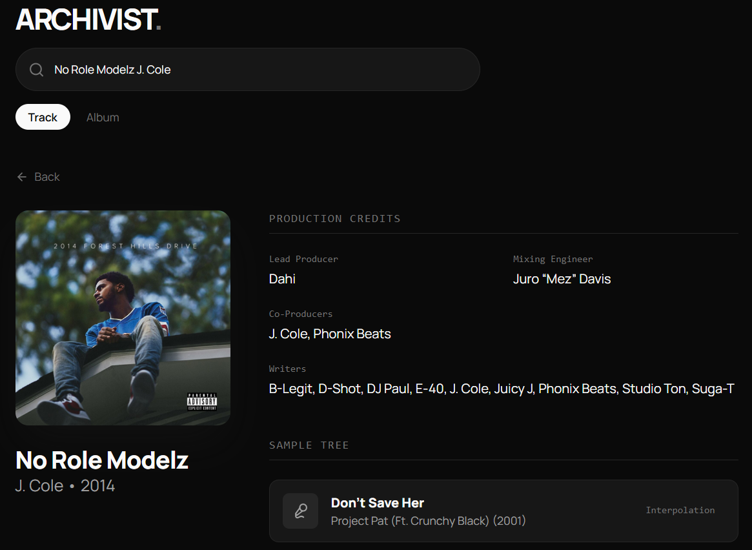

# Archivist.


A motion-driven metadata archive for music. Search a track or an album and instantly see its production credits (lead producer, co-producers, writers, mixing engineer) and an interactive **Sample Tree** of the songs it samples or interpolates.

**Live demo:** https://music-archivist.vercel.app/



## Features

- **Track search:** credits, release year and cover art.
- **Album search:** cover, year and a numbered tracklist. Click a track to open its credits.
- **Sample Tree:** click any sample to search for the original song and follow the chain back.
- **Friendly error screens** (not found, server problem, offline, too many requests).
- Dark, minimal interface with spring-based staggered entrance animations.

## Tech stack

| Part | Technology |
| --- | --- |
| Frontend | React, Vite, Tailwind CSS, Framer Motion, lucide-react |
| Backend | ASP.NET Core 8 Web API (C#) |
| Data | [Deezer API](https://developers.deezer.com/api) (basics, no key needed) and [Genius API](https://docs.genius.com/) (credits and samples) |
| Hosting | Vercel (frontend), Render in a Docker container (backend) |

## How it works

```
Browser (React on Vercel)
        |  GET /api/archive/search?q=...   or   /api/archive/album?q=...
        v
ASP.NET Core API (Render)
        |-- Deezer: title, artist, cover art, year, BPM, tracklist
        |-- Genius: producers, writers, mixing engineer, samples
        '-- In-memory cache (12 h) and per-visitor rate limit (30 requests/min)
```

Genius results are only used when both the title and the artist match, so a wrong song's credits are never shown. If no match is found, the credits show "Not listed".

## Run it locally

You need the [.NET 8 SDK](https://dotnet.microsoft.com/download) and [Node.js](https://nodejs.org/).

**1. Get a Genius token** (free): create an API client at https://genius.com/api-clients and generate a *Client Access Token*.

**2. Backend**

```bash
cd backend/Archivist.Api
dotnet user-secrets init
dotnet user-secrets set "Genius:AccessToken" "your-token"
dotnet run --launch-profile https
```

**3. Frontend**

```bash
cd frontend
npm install
npm run dev
```

Open http://localhost:5173. If your API runs on a different port than `7266`, create `frontend/.env` containing `VITE_API_URL=https://localhost:YOUR_PORT`.

## Tests

```bash
cd backend/Archivist.Api.Tests
dotnet test
```

- **Unit tests** cover the matching logic (name cleaning, picking the right Deezer result), including the real wrong-result bugs found during testing.
- **Integration tests** start the API in memory with fake music services and check the endpoints, 404s, rate limiting and CORS. No internet or API keys needed.

## Deployment

**Backend (Render, Docker)**
- Root directory: `backend/Archivist.Api` (it contains the `Dockerfile`).
- Environment variables:
  - `Genius__AccessToken` = your Genius token
  - `PORT` = `8080`
  - `Cors__Origins__0` = your Vercel address, e.g. `https://music-archivist.vercel.app`

**Frontend (Vercel)**
- Root directory: `frontend`.
- Environment variable: `VITE_API_URL` = your Render address. Redeploy after changing it.

## Project structure

```
Archivist/
  backend/Archivist.Api/   ASP.NET Core API (controllers, services, models, Dockerfile)
  frontend/                React + Vite app
```

## Known limitations

- The free Render plan sleeps after 15 minutes without traffic, so the first search after a break can take a while.
- Genius credits and samples are crowd-sourced, so some songs have gaps.
- Search works best with the artist included, e.g. `Kendrick Lamar DNA`.
- Deezer and Genius have their own usage limits, which is why results are cached and requests are rate limited.

## Credits

Music metadata from Deezer and Genius. This project isn't affiliated with either service.